# Developer workflows

How the team works with this repository, from a new developer's first `make setup` to rolling back prod. Each section has a short description and a PlantUML activity diagram:

- the **lanes** show where a step runs (you in the dev container, GitLab CI, or Databricks);
- each **box** is a step, with the command to type in `monospace`;
- the **note** next to it says what the step produces.

Names in the diagrams use the sample product `sample_product` and a developer alias `jodo`. Replace them with your own product name and alias. Terms in bold are defined in [`GLOSSARY.md`](../GLOSSARY.md).

> Status: the development tooling is verified offline and on the local Spark engine; the deployment is verified offline only. The diagrams describe the intended flow; see [`ci-cd.md`](ci-cd.md), "Not verified yet".

| # | Workflow | When |
|---|---|---|
| [0](#0-set-up-your-environment-and-run-dbt) | Set up your environment and run dbt | First day, new machine |
| [1](#1-develop-a-feature-up-to-a-merge-request) | Develop a feature up to a merge request | Every change |
| [2](#2-release-and-deploy) | Release and deploy | Shipping merged work to prod |
| [3](#3-make-a-breaking-change-to-the-published-interface) | Make a breaking change to the published interface | Changing a published column, type or grain |
| [4](#4-create-and-refresh-source-clones-and-samples) | Create and refresh source clones (and samples) | Stale or broken dev data |
| [5](#5-roll-back-a-broken-release) | Roll back a broken release | Prod is broken after a deploy |
| [6](#6-release-a-fix-that-is-not-on-main-hotfix) | Release a fix that is not on `main` (hotfix) | Exceptional; not supported by default |
| [7](#7-a-release-fails-in-product-dev) | A release fails in product dev | The release's test run fails |
| [8](#8-add-a-new-source) | Add a new source | New upstream data |
| [10](#10-try-a-change-on-the-local-engine-no-databricks) | Try a change on the local engine (no Databricks) | Offline, or Databricks unavailable |
| [11](#11-create-a-new-data-product-from-the-template) | Create a new data product from the template | Once per data product |

Where things live:

| Environment | Catalog / schemas | Written by |
|---|---|---|
| Personal environment | team catalog, `<product>__<alias>__<layer>` | you (your own login) |
| MR build | team catalog, `<product>__mr__<layer>` | the MR pipeline (team identity) |
| Product dev | product dev catalog, `<layer>` | the release pipeline (product dev identity) |
| Product prod | product prod catalog, `<layer>` | the prod job on its schedule (product prod identity) |

**Changing a diagram:** the sources are the `.puml` files in [`diagrams/`](diagrams/), and this page shows the committed `.svg` next to each (GitHub and many GitLab instances don't render PlantUML in Markdown). Edit the `.puml` file, render the SVGs on the host (needs Podman or Docker; with Docker, use `docker` and `--user "$(id -u):$(id -g)"` instead of `--userns=keep-id`), and commit both files:

```sh
podman run --rm --userns=keep-id -e JAVA_TOOL_OPTIONS=-Duser.home=/tmp \
  -v "$PWD/docs/diagrams:/data:Z" docker.io/plantuml/plantuml:1.2025.4 \
  -tsvg -charset UTF-8 "/data/*.puml"
```

In the source, `~` before `__` or `--` stops PlantUML from reading them as underline or strikethrough; it isn't shown in the rendered diagram.

---

## 0. Set up your environment and run dbt

You need: access to the dev workspace, and the team catalog (ask the platform team if not). Nothing else has to be set up by hand.

1. **Open the repository in the dev container** (VS Code: "Reopen in Container"). The container has the pinned uv, Databricks CLI and Python; see [`dev-container.md`](dev-container.md).
2. **Log in the Databricks CLI** with your own account. `make setup` uses this login to look up your name and later to download the product dev manifest.
3. **`make setup`**: installs the locked Python packages, checks the login, suggests a **developer alias** (two letters of your first and last name), and writes the gitignored `./profiles.yml` with `schema: <product>__<alias>` in the team catalog. Then `dbt deps`.
4. **`make clone-sources`**: shallow clones of every source into your own `…__src_clone` schema. By default your builds read these, not prod.
5. **`make build`** (`dbt build`): builds and tests everything into your personal environment. The first dbt command opens a browser for dbt's own OAuth login.

Nothing you run can write outside `<product>__<alias>*`: the schema name always comes from your profile ([`generate_schema_name.sql`](../tools/dbt_platform/macros/generate_schema_name.sql) in the platform package). `make clean-dev` drops the whole environment when you want to start over.

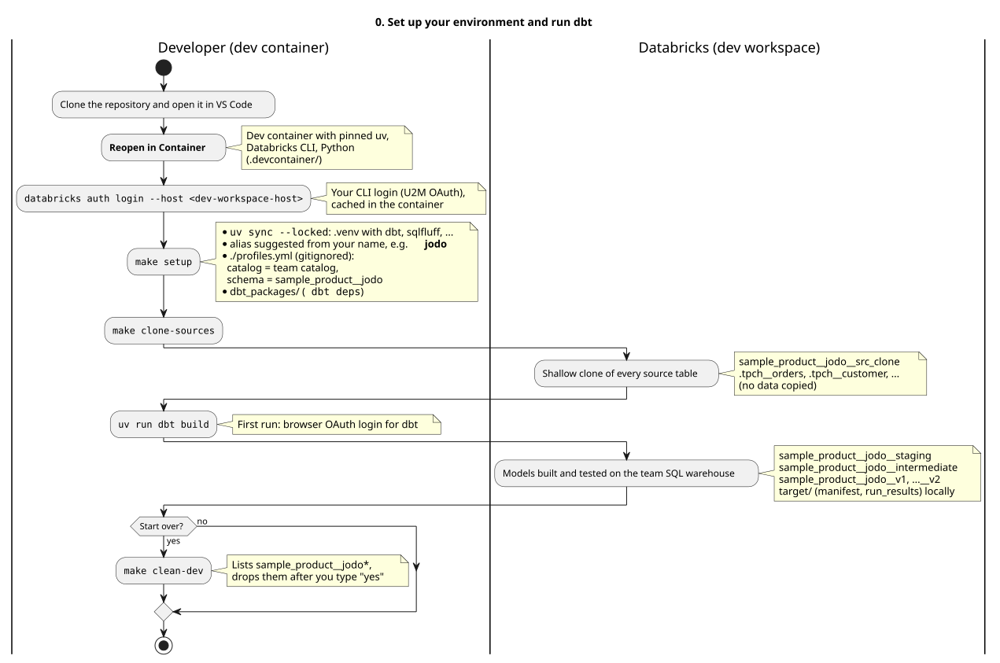

Source: [`diagrams/workflow-0-setup.puml`](diagrams/workflow-0-setup.puml)

---

## 1. Develop a feature up to a merge request

The inner loop runs in your personal environment; the MR pipeline is the gate. **A green MR means the coding is done** (ADR 0007): merging deploys nothing.

1. **Branch** from an up-to-date `main`.
2. **Change models** and build only what you need: `make build SELECT=<model>+` or `SELECT=+<model>` (`make run`, `make test` and `make compile` take the same options), or `make build-changed`, which builds only what you changed (`state:modified+`) and reads everything unchanged from product dev (needs a release in product dev first).
3. **Check before pushing**: `make lint parse` (sqlfluff, yamllint, offline `dbt parse` with the deploy profile) and, if you touched `tools/dbtp/`, macros, the bundle or CI, `make test-tooling`.
4. **Push and open a merge request.** The pipeline runs the static checks and then the **MR build**: it drops `<product>__mr__*` and builds the whole project into it from prod sources, as the team identity. MR builds run one at a time (`resource_group: mr-build`), so a second MR waits for the first.
5. **Review and merge.** The `main` pipeline runs the static checks again. Nothing is deployed.

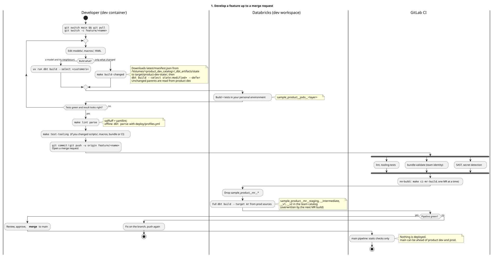

Source: [`diagrams/workflow-1-feature.puml`](diagrams/workflow-1-feature.puml)

---

## 2. Release and deploy

Releases deploy, merges don't (ADR 0007). A release is a GitLab release (and its tag) on a `main` commit; it can bundle several merged MRs. One **release artifact** is built per tag and promoted unchanged: first to product dev, where the job run is the release's test, then, after a manual step, to prod (ADR 0008).

1. **Create a GitLab release** on a `main` commit with a tag like `v1.4.0` (letters, digits, `.`, `_`, `+`, `-`; no `/`).
2. **`release-check`** refuses an invalid tag or a commit that isn't on `main`.
3. **`release-artifact`** builds `<product>-<tag>.tar.gz` (bundle, dbt project, installed packages, `RELEASE.json`) and stores it once in the package registry. A re-run reuses it.
4. **`product-dev`** deploys the artifact to product dev and runs the job. The job builds the whole project and then publishes `manifest.json` and `run_results.json` to the artifacts volume. If the run fails, the release stops here.
5. **`validate-prod`** validates the same artifact against the prod target.
6. **Approve and start `deploy-prod`** (manual). It deploys the same artifact to prod and does **not** start a run: the prod schedule builds the new version at its next run.

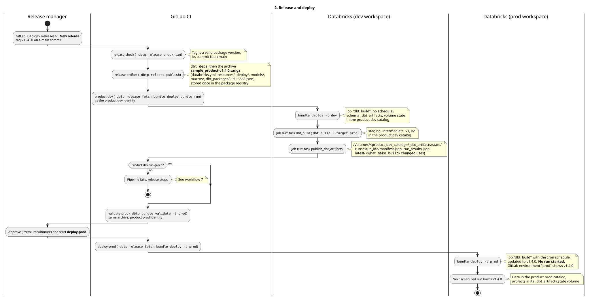

Source: [`diagrams/workflow-2-release.puml`](diagrams/workflow-2-release.puml)

---

## 3. Make a breaking change to the published interface

Consumers read the published interface from the `published` schema. A breaking change (removing or renaming a column, changing a type or the grain) is not stopped by any tool: it is a team decision, agreed with consumers before it is merged, and reviewers check MRs that touch `models/published/` for it (ADR 0010). There is no built-in versioning; if a product needs old and new side by side, see [`published-interface.md`](published-interface.md).

Non-breaking changes (a new column, a fix that keeps the contract) go through the normal feature flow.

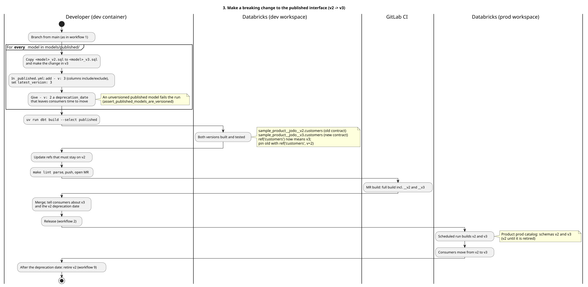

Source: [`diagrams/workflow-3-breaking.puml`](diagrams/workflow-3-breaking.puml)

---

## 4. Create and refresh source clones (and samples)

On personal targets, `source()` reads your own copies of the sources, not prod (ADR 0005). The variable `dev_source_mode` picks which copy:

| Mode | Reads | How to get it |
|---|---|---|
| `clone` (default) | `<product>__<alias>__src_clone.<source>__<table>` | `make clone-sources` |
| `prod` | the prod source directly | `--vars '{dev_source_mode: prod}'` for one run |
| `sample` | `…__src_sample` | **not implemented yet**: dbt stops with an error that says so |

Shallow clones copy no data; they reference the prod files at the moment of cloning, so they don't see newer prod data. Run `make clone-sources` again when you need fresher data, after you add a source, or when a clone breaks because prod ran `VACUUM` and removed files the clone still references. Views can't be shallow-cloned: the clone schema gets a view of the same name that reads prod. MR builds and deployed jobs always read prod; the mode is ignored there.

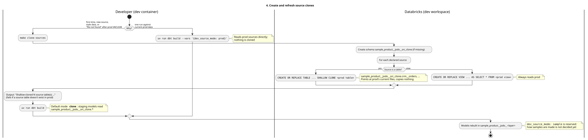

Source: [`diagrams/workflow-4-clones.puml`](diagrams/workflow-4-clones.puml)

---

## 5. Roll back a broken release

A rollback redeploys an earlier release's artifact: open that release's pipeline and re-run its `deploy-prod` job (ADR 0007). That brings back the earlier code and job definition. **Data is not rolled back**: the tables keep what the broken version wrote until the job runs again with the old code, at the next scheduled run or when you start it by hand.

This needs, once per project: "Allow job retries for rollback deployments" under Settings → CI/CD → General pipelines → "Prevent outdated deployment jobs", and the old release package must still be in the package registry (don't delete them).

Then fix forward: fix on `main` through an MR and make a new release.

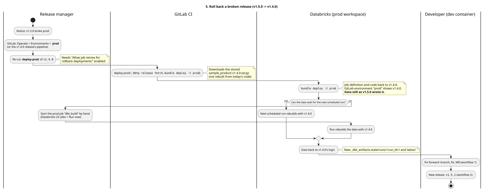

Source: [`diagrams/workflow-5-rollback.puml`](diagrams/workflow-5-rollback.puml)

---

## 6. Release a fix that is not on `main` (hotfix)

**Not supported by default** (ADR 0007). The supported path is to fix forward on `main` and release, even when `main` has other merged changes: those changes passed their MR builds and the product dev run tests them again.

When you really can't release what's on `main`, the documented route is to branch from the release tag, fix, and tag a release on that branch. `release-check` refuses that tag on purpose (its commit is not on `main`), so a maintainer has to bypass the check deliberately. The fix must then be brought into `main`, or the next release brings the bug back. Everything after `release-check` is the normal release: the same artifact goes to product dev, is tested there, and then goes to prod.

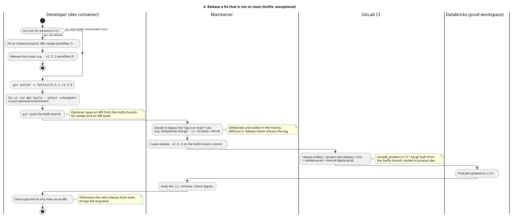

Source: [`diagrams/workflow-6-hotfix.puml`](diagrams/workflow-6-hotfix.puml)

---

## 7. A release fails in product dev

The product dev run is the release's test. When it fails, nothing reaches prod. The failed tag can't be "fixed": re-running its pipeline redeploys the same stored artifact. Fix on `main` and make a new release with a new tag. Product dev keeps the failed candidate deployed until then; `make build-changed` keeps using the manifest of the last **successful** run, because artifacts are only published after a green build.

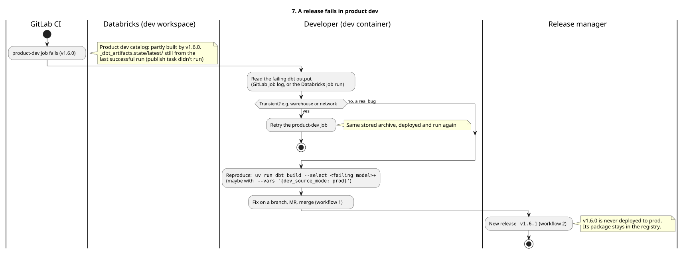

Source: [`diagrams/workflow-7-failed-release.puml`](diagrams/workflow-7-failed-release.puml)

---

## 8. Add a new source

The source YAML names the source's prod location; every environment reads that, except personal environments, which read their clones. After adding the source, clone it before building in your environment (the default mode reads clones).

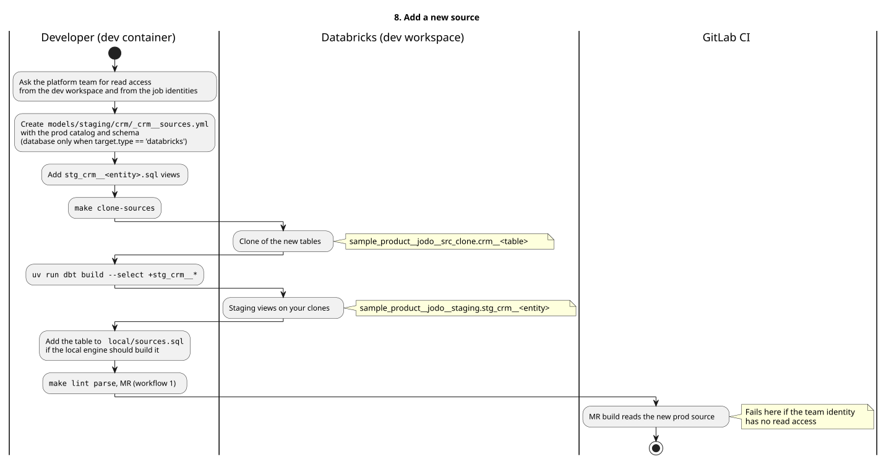

Source: [`diagrams/workflow-8-new-source.puml`](diagrams/workflow-8-new-source.puml)

---

## 10. Try a change on the local engine (no Databricks)

`local/` runs the project on Apache Spark + Delta Lake in containers, through dbt-spark. Use it offline, or to try a change without a warehouse. Run these on the **host** (Podman or Docker, plus uv for `dbtp`), not in the dev container. There is no Unity Catalog locally, and a green local build doesn't replace a Databricks build.

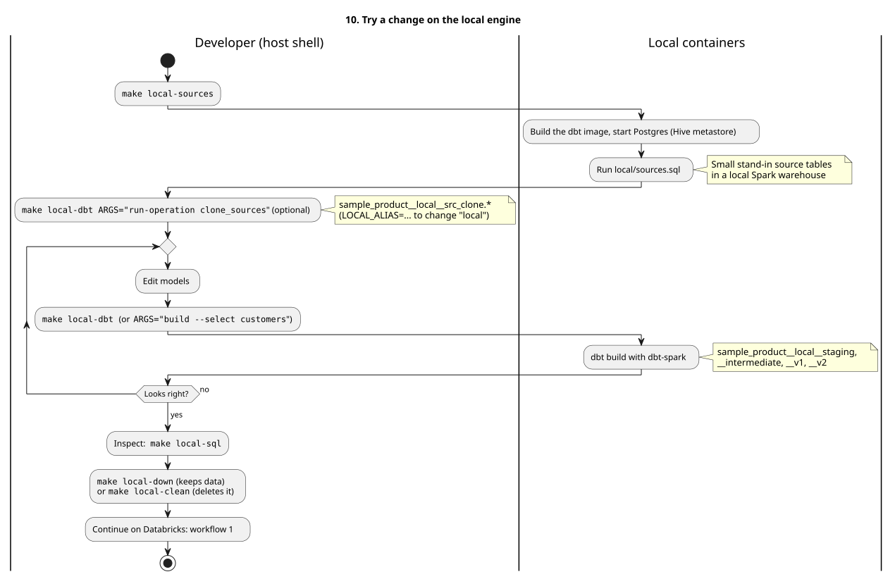

Source: [`diagrams/workflow-10-local.puml`](diagrams/workflow-10-local.puml)

---

## 11. Create a new data product from the template

Once per data product. The full checklist is in [`README.md`](../README.md); this is its shape.

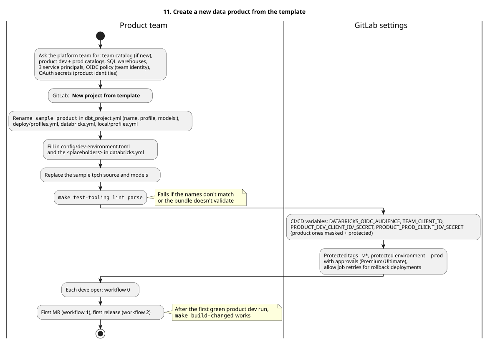

Source: [`diagrams/workflow-11-new-product.puml`](diagrams/workflow-11-new-product.puml)
